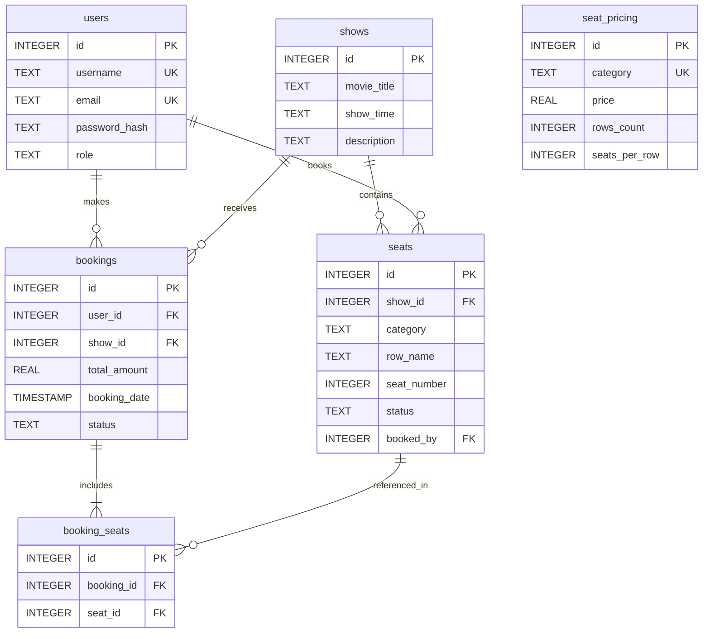
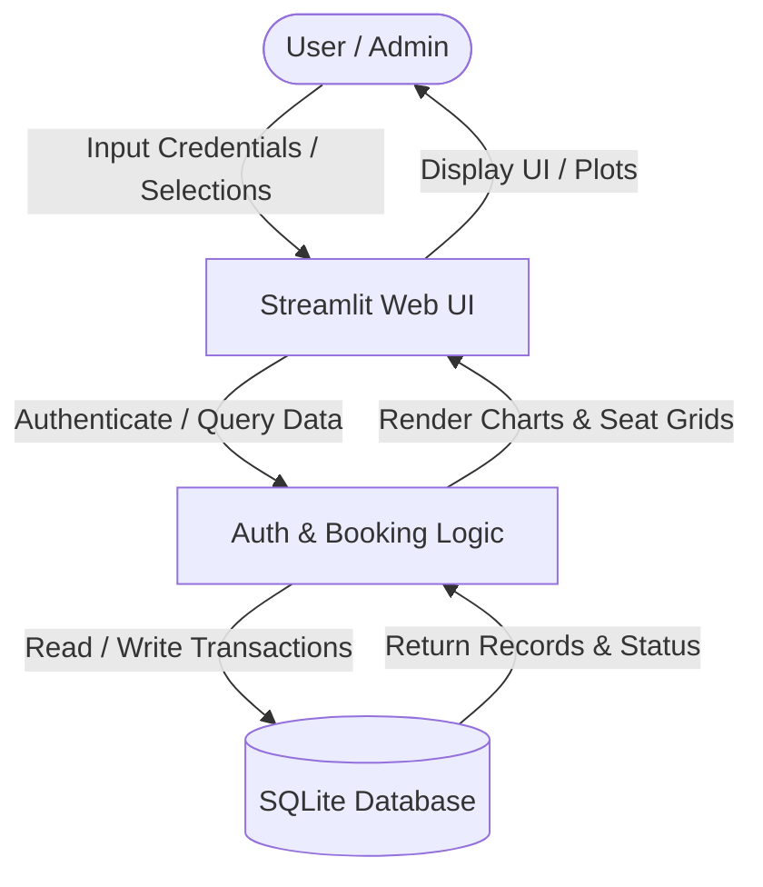

# 🎬 Cinema Seat Booking & Analytics System

[](https://www.python.org/)
[](https://streamlit.io/)
[](https://www.sqlite.org/)
[](https://opensource.org/licenses/MIT)

A full-stack, interactive movie theater seat reservation and expense analytics application built purely in Python using **Streamlit**, **Pandas**, **Plotly**, and **SQLite**.

---

## 📑 Table of Contents
1. [Purpose](#-purpose)
2. [Features](#-features)
3. [File Structure](#-file-structure)
4. [Entity-Relationship (ER) Diagram](#-entity-relationship-er-diagram)
5. [Data Flow Diagram (DFD)](#-data-flow-diagram-dfd)
6. [Installation & Setup](#-installation--setup)
7. [Usage Guide](#-usage-guide)
8. [Pros & Cons](#-pros--cons)
9. [Limitations](#-limitations)
10. [Known Bugs & Security Vulnerabilities](#-known-bugs--security-vulnerabilities)
11. [Future Updates](#-future-updates)
12. [Acknowledgments & Contribution](#-acknowledgments--contribution)

---

## 🎯 Purpose
The primary objective of this project is to build a robust, modular, state-managed Python web application without relying on heavy JavaScript frontend frameworks. It demonstrates relational database design, dynamic UI generation in Streamlit, multi-seat transaction management, and automated data visualization using Pandas and Plotly.

---

## ✨ Features
* **User Authentication & Management:** Secure registration, login, session state handling, password updating, and email-based password recovery.
* **Interactive Dynamic Seat Mapping:** 
  * Category-based breakdown (Silver, Gold, Platinum, and custom sections like Diamond).
  * Color-coded availability indicators (🟩 **Green** for available, 🟥 **Red** for booked).
  * Multi-seat selection capability in a single session.
* **Payment Simulation & Booking Checkout:** Total cost calculation, mock card processing, and atomic database commitment.
* **Ticket Cancellation:** Instant seat release back to available status upon cancellation.
* **Personal User Dashboard:** View past/upcoming bookings and analyze monthly and yearly ticket expenses through interactive **Plotly** charts.
* **Comprehensive Admin Control Panel:** 
  * Add new movie shows and times.
  * Adjust ticket pricing, row counts, and seats per row dynamically.
  * Create brand-new custom seating sections on the fly.

---

## 🗂️ File Structure
```text
cinema_app/
│
├── app.py              # Main application entry point & router
├── database.py         # SQLite schema initialization & connection handler
├── auth.py             # User authentication, registration, & password reset
├── booking.py          # Show selector, dynamic seat grid, & checkout engine
├── user_dashboard.py   # Profile manager, booking history, & Plotly analytics
├── admin.py            # Admin control center for shows, pricing, & sections
└── cinema_app.db       # Local SQLite relational database (auto-generated)

```

---

## 🗄️ Entity-Relationship (ER) Diagram



---

## 📊 Data Flow Diagram (DFD)



---

## 📦 Installation & Setup

### Prerequisites

* Python 3.9 or higher installed on your system.

### Step 1: Clone or Download the Project

Navigate to your project directory in the terminal.

### Step 2: Install Dependencies

Run the following command to install the required Python packages:

```bash
pip install streamlit pandas plotly

```

### Step 3: Run the Application

Launch the Streamlit server:

```bash
streamlit run app.py

```

### 🔑 Default Admin Credentials

* **Username:** `admin`
* **Password:** `password123`

---

## 🚀 Usage

1. Open the local URL provided by Streamlit in your browser (`http://localhost:8501`).
2. Log in using the **Admin** account to add movie shows or configure seat prices/sections.
3. Switch to a user account (or register a new one) to browse shows, pick seats, and complete checkout.
4. Visit your **User Dashboard** to inspect your expense graphs or cancel upcoming bookings.

---

## ⚖️ Pros & Cons

### Pros

* **Pure Python Stack:** No need to configure separate Node.js or SQL server instances; runs locally out of the box.
* **Reactive UI:** Streamlit handles state management smoothly without complex callback boilerplate.
* **Interactive Visualizations:** Plotly charts provide clean, hoverable financial analytics.

### Cons

* **Single-Node Database:** SQLite is file-based and not optimized for massive concurrent web traffic.
* **Simulated Payments:** Does not integrate with live financial gateways out of the box.

---

## ⚠️ Limitations

* Designed primarily for local deployment, desktop utilities, or academic/portfolio demonstration.
* Concurrency handling is limited by SQLite's file-locking mechanism during high-load simultaneous bookings.

---

## 🐛 Known Bugs & Security Vulnerabilities

* **Password Hashing:** Uses standard SHA-256 without cryptographic salting (sufficient for educational use, but production environments should use `bcrypt` or `argon2`).
* **Session State Timeout:** Prolonged idle sessions in Streamlit may require a page refresh to re-establish database connection states.

---

## 🔮 Future Updates

* [ ] Integration with real payment gateways (Stripe / Razorpay).
* [ ] Automated email/SMS booking confirmation notifications.
* [ ] QR code generation for digital movie tickets.
* [ ] Multi-hall and multi-screen cinema multiplex support.

---

## 🙏 Thanks, Like, Share & Contribute

### Acknowledgments

Special thanks to the open-source community behind Streamlit, Pandas, and Plotly for making rapid prototyping in Python seamless.

### ❤️ Show Your Support

If you found this project helpful or inspiring, please give it a ⭐ on GitHub! Share it with fellow developers learning full-stack Python.

### 🤝 Contributing

Contributions are always welcome!

1. Fork the repository.
2. Create your feature branch (`git checkout -b feature/AmazingFeature`).
3. Commit your changes (`git commit -m 'Add some AmazingFeature'`).
4. Push to the branch (`git push origin feature/AmazingFeature`).
5. Open a Pull Request.

